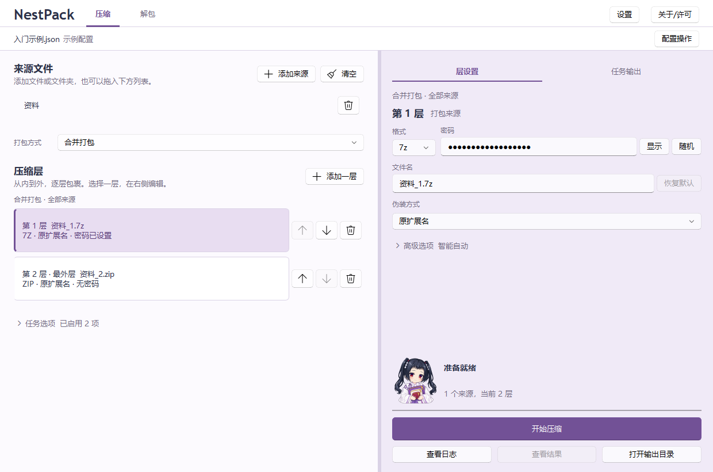

<p align="center">
  
</p>

<h1 align="center">NestPack</h1>

**RAR、7z、ZIP 多层嵌套压缩与自动逐层解包**


[](LICENSE)

NestPack 将文件或文件夹打包成多层压缩包。每层可独立选择 RAR、7z 或 ZIP，也可设置各自的文件名、密码和分卷大小。解包时选择最外层归档，NestPack 会按内容识别格式并逐层解开。支持 Windows 图形界面和命令行，以及 Linux 命令行。

NestPack creates and automatically extracts nested RAR, 7z, and ZIP archives. It supports per-layer passwords, split archives, batch compression, embedding archives in MP4 videos, and RAR self-extracting archives (SFX).

**[下载程序](https://github.com/codeTianZun/NestPack/releases) · [图文入门](docs/入门教程.md) · [常见问题](docs/常见问题.md) · [GitHub 下载与反馈指南](docs/GitHub下载与反馈.md)**

> **版本说明**：本页介绍 **v1.1.0** 的界面与功能。下载程序前请核对发布说明；当前源码的运行与构建方法见[打包说明](打包说明.md)。

## 主要功能

| 功能 | 可以做什么 |
|---|---|
| **混合格式嵌套与加密** | 从内到外逐层设置格式、名称和密码，例如用 ZIP 包裹加密的 7z，再套一层 RAR。 |
| **一键解包** | 从最外层归档或首卷开始，自动识别 RAR、7z、ZIP 和分卷套，支持扩展名已改成 `.bin` 等情况。可提供多个候选密码，无需按层排序。 |
| **批量压缩** | 将多个文件或文件夹合并打包，或让每个来源生成独立的一套压缩包。分别打包时可为各来源设置不同的层数、格式和密码。 |
| **分卷压缩** | 每层可独立设置分卷大小。需要拆分最终交付文件时，在最外层设置分卷。 |
| **MP4 视频融合** | 将单文件 RAR、7z 或 ZIP 归档与 MP4 合成可播放的视频，也可从成品中提取原归档。 |
| **RAR 自解压（SFX）** | 生成 Windows `.exe` 或 Linux `.sfx` 自解压文件。 |
| **命令行自动化** | GUI 与 CLI 共用 JSON 任务配置。CLI 支持直接传参、预览压缩计划和输出 JSON 结果，便于脚本调用。 |

## 压缩界面与示例



例如，给“资料”文件夹加两层压缩：

```text
资料文件夹 → 资料_1.7z（内层，有密码）→ 资料_2.zip（外层）
```

分享时发送最外层的 `资料_2.zip`，并向接收者提供内层密码。接收者在 NestPack 中选择这个 ZIP，程序会逐层解开，恢复原始文件。

## 下载与准备

打开[发布页](https://github.com/codeTianZun/NestPack/releases)，找到 **Assets**（下载文件列表），按使用方式选择：

| 使用方式 | 文件 | 启动方式 |
|---|---|---|
| Windows x64 图形界面 | `NestPack-v1.1.0-windows-gui.exe` | 双击运行 |
| Windows x64 命令行 | `NestPack-v1.1.0-windows-cli.exe` | 双击进入数字菜单，或在终端运行 |
| Linux x86_64 命令行 | `NestPack-v1.1.0-linux-cli` | 赋予执行权限后运行 |

三个程序均自带 Python 运行时，按需下载即可。Windows 图形界面用户选择 `NestPack-v1.1.0-windows-gui.exe`；**Source code** 是源码包。下载位置和更新步骤见[GitHub 下载与反馈指南](docs/GitHub下载与反馈.md)。

NestPack 还需要调用压缩工具：**7z 和 ZIP 使用 7-Zip，RAR 使用 WinRAR / RARLAB rar**。当前界面的「设置」提供检测与安装入口；[入门教程](docs/入门教程.md#准备压缩工具)以只需 7-Zip 的两层任务为例。

## 第一次使用

[图文入门教程](docs/入门教程.md)按下面的顺序带你完成一次操作：

1. 准备压缩工具，并确认检测成功。
2. 添加一个文件夹，把压缩层调整为内层 7z、外层 ZIP。
3. 设置内层密码，选择输出目录，确认最终文件名。
4. 点击「开始压缩」，完成后保存密码清单。
5. 切换到「解包」，选择最外层 ZIP，恢复文件。

默认会在自检通过后清理中间层，输出目录通常只留下最外层文件。原始来源文件保留。

## 按场景继续使用

- [多个文件夹分别打包](docs/进阶用法.md#多个文件夹分别打包)：每个文件夹生成独立的一套压缩包。
- [大文件分卷](docs/进阶用法.md#大文件分卷)：设置每卷大小，确认需要发送哪些文件。
- [视频融合](docs/进阶用法.md#视频融合)：选择载体视频，生成和解包 MP4 成品。
- [RAR 自解压](docs/进阶用法.md#rar-自解压)：为 Windows 接收者制作单层自解压 EXE。
- [保存和复用设置](docs/入门教程.md#保存和复用设置)：下次继续使用相同的来源、压缩层和输出位置。

遇到报错时先查[常见问题](docs/常见问题.md)。反馈问题的步骤和可复制的填写格式见[反馈指南](docs/GitHub下载与反馈.md#遇到问题怎么反馈)。

## 命令行入口

Windows 双击 `NestPack-v1.1.0-windows-cli.exe` 可进入数字菜单。Linux 在下载文件所在目录运行：

```bash
chmod +x NestPack-v1.1.0-linux-cli
./NestPack-v1.1.0-linux-cli
```

菜单提供新建任务、解包、修改配置和检测工具等操作。需要直接传入参数时，可查阅[命令行用法](使用说明.md#cli-直接参数与-ai-调用)。

## 文档与源码

| 文档 | 适合什么时候看 |
|---|---|
| [图文入门](docs/入门教程.md) | 第一次使用，跟着完成压缩、解包和分享 |
| [进阶用法](docs/进阶用法.md) | 需要分别打包、分卷、视频融合或自解压 |
| [GitHub 下载与反馈](docs/GitHub下载与反馈.md) | 不熟悉下载页面，或需要更新、提交问题 |
| [常见问题](docs/常见问题.md) | 操作中遇到工具、密码、输出或界面问题 |
| [使用说明](使用说明.md) | 查询全部界面选项、命令行参数和 JSON 字段 |
| [打包说明](打包说明.md) | 从源码运行或构建三个可执行程序 |
| [开发文档](开发文档.md) | 维护代码、了解模块职责与架构 |

## 许可与反馈

项目代码和文档采用 [GPL-3.0-only](LICENSE)。第三方版权与许可见 [THIRD_PARTY_NOTICES.md](THIRD_PARTY_NOTICES.md)。RAR / WinRAR 由使用者自行安装并遵守其许可条款。

问题和建议请提交至 [GitHub Issues](https://github.com/codeTianZun/NestPack/issues)。
